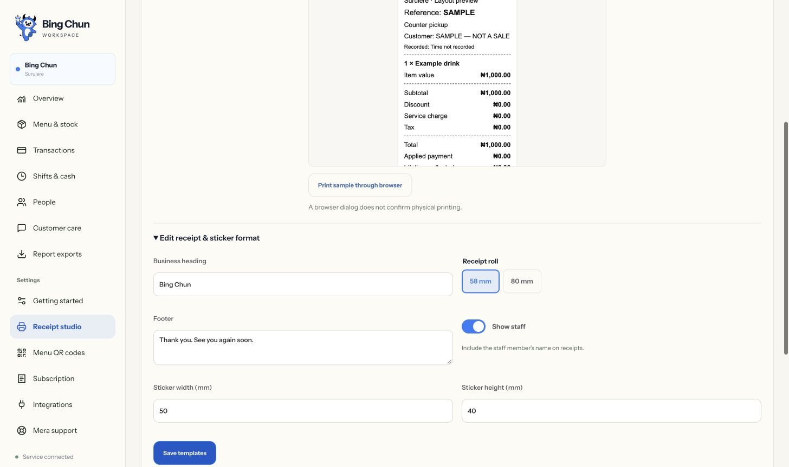
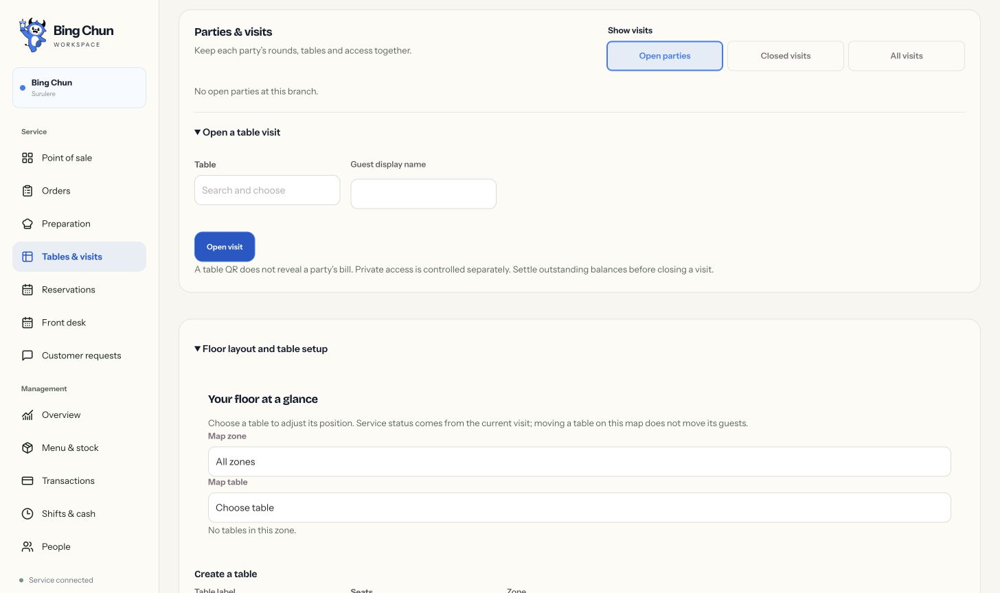

# Mera round-two UX audit

Baseline: `mera-ux-next` at `3d0d0d0`, based on round-one `547f9fd`. Audit mode precedes fixes. This report distinguishes source inspection, prior-round screenshots and new browser observations. No deployment is authorized.

## Evidence and coverage

All Mera source areas were inventoried by the coordinator and three domain agents. The complete workspace field inventory accompanies this report; dynamically generated fields are marked as source declarations, not runtime counts. Source-only scores never imply visual or responsive verification. Round-one screenshots remain valid baseline evidence for unchanged preparation, stock, POS, payment, setup and guest reservation controls. New Chrome observations confirm the20-destination navigation, print-format controls and floor/table creation screens (screenshots below). Bill splitting needs populated synthetic visits/orders; protected platform needs an isolated operator. These journeys remain pending browser verification at this baseline and will be recorded as checked only after observation.

The skill references `workspace/preparation-v2.css`, which does not exist. Actual imported `workspace/preparation.css` was inspected. In-app browser bootstrap failed due missing native classic-level build; Chrome fallback is used. Fresh isolated preview3009/database55449, no existing databases reset.

## Baseline corrections

- Feedback already has five star radios and category choices; retain and verify rather than redo.
- ReservationRequest already uses shared DateTimePicker; no datetime-local replacement is necessary.
- Orders already collapses advanced filters; preserve.
- Additional-branch creation is a distinct operation, incorrectly mounted as first-branch setup.
- Subscription proposals are owner-authorized; approval and service-status mutation belong to platform operators. Do not mistake authorized owner proposals for operator controls.

# Onboarding source audit — Audit A

Source inspection only. Root owns browser evidence. No source changes or deployment performed. Visual-system, operational density and responsive scores remain unverified rather than inferred from JSX.

## Findings

| Screen | Job | Finding | Evidence | Verdict | Effort | Impact |
|---|---|---|---|---|---|---|
| Guided First branch | Configure the existing first branch | Embeds additional-branch creation after organization creation already created the first branch | `src/mera/workspace/OwnerSetup.tsx:173`; `BranchAdministration.tsx:234`; `CreateOrganization.tsx:120` | Cut this mount from guided setup; keep standalone branch administration | S | High |
| Business details / Launch | Collect reachable customer contact once | Business contact and phone save only into onboarding.data; readiness and receipt consumers use other contact fields, including settings.publicContact | `BusinessDetails.tsx:30`, `:118`; `server/mera/readiness.js:70`; `server/mera/printing.js:18` | Merge into one explicit public-contact collection and reuse through existing launch-policy body | M | High |
| Business details | Configure service | Scalar onboarding serviceMode has no operational consumer found beyond reloading the form; branch.settings.serviceModes is the configured branch field | `BusinessDetails.tsx:98`; `BranchSettings.tsx:261`; source search for onboarding contact/phone/serviceMode consumers | Cut unused scalar question; retain stored legacy data | S | Medium |
| Guided setup | Reach readiness with clear next step | Nine outer steps contain another six-step settings wizard; methods appear in final launch section after Payments step | `OwnerSetup.tsx:31`, `:183`, `:228`; `BranchSettings.tsx:381` | Remodel into Account, Business, Branch, Payments, Go live | M | High |
| Branch creation | Specify actual branch defaults | Currency has a single NGN option and no meaningful change handler; API accepts only NGN | `BranchAdministration.tsx:433`; `server/mera/workspace-admin.js:100` | Update to readonly value; retain payload currency | S | Medium |
| Launch | Review and publish intentionally | Repeats contact entry and stacks policy acknowledgement, save policy, publication acknowledgement, publication action | `LaunchReadiness.tsx:174`, `:184`, `:204`, `:221` | Merge review UI, preserve sequential policy persistence and authoritative launch gate | M | High |
| Account verification | Establish verified owner access | Existing provider recovery and owner-status distinctions protect against confusing platform operators with owners | `OwnerVerification.tsx:34`, `:137`, `:159`; `ProviderSignup.tsx:106`, `:180` | Keep contracts and recovery; unify progress framing only | S | High |

## Field and data-flow inventory

| Collected datum | Persistence/API | Actual consumer / disposition |
|---|---|---|
| Owner name, email, password | ProviderSignup `/identity/provider/register` with requestKey; simulator Signup `/identity/register` remains separate | Real owner identity/authentication. Keep. Owner name is actor identity, not public business contact. Password must never be persisted in browser recovery. |
| Verification fragment / explicit verification | Provider verification; owner-status and owner-resend gates | Explicit activation and organization-creation permission. Keep; no automatic link GET activation, synthetic identity promotion or operator bypass. |
| Recovery email/password | `/identity/provider/recover-account` | Credential-authorized recovery, not a second business-contact question. Keep. |
| Organization name, slug, first branch name | CreateOrganization POST `/organizations` `{name,slug,branchName}` at line120 | Canonical organization/branch identity; slug uniqueness and menu routing. Keep body and address advisory/final-claim distinction. |
| Business contact, phone | BusinessDetails PATCH `/organizations/:id/onboarding` `{step:1,data:{contact,phone,serviceMode}}` at line118 | Search finds only BusinessDetails reload of these onboarding fields. They do not satisfy readiness. Merge collection into one clearly named public contact, carrying its value into existing launch-policy review; do not silently infer public contact from owner identity. Preserve old stored data. |
| Scalar primary service | Same onboarding body | No operational consumer found outside form reload. Cut question in unified flow; use branch serviceModes. |
| Additional branch name, timezone, currency, serviceModes, cutoff, requestKey | BranchAdministration POST `/organizations/:id/branches` at line234 | Actual additional-branch creation. Keep separate administration; do not ask during existing first-branch configuration. |
| Branch address | BranchSettings PATCH branch `/settings` | Receipt branch context and configured location. Keep. |
| Branch timezone and trading-day cutoff | Same settings API; server index2324–2326 writes branch columns | Trading-date/report boundaries, service-hour ordering checks. Keep once; later show readonly summary with Edit link. |
| Currency | Branch currency, creation contract fixed NGN | Prices/reporting/readiness checks; readonly NGN, unchanged API value. |
| Service modes | Branch settings | Persisted operational branch configuration. Keep one collection; scalar onboarding duplicate removed. Do not imply this alone enables reservation policy. |
| Service hours | Branch settings | Server index948 and2071 evaluate ordering availability using timezone. Keep; do not conflate with reservation slot availability. |
| orderingPaused, showSoldOut, holdMinutes | Branch settings | Ordering availability, public-menu stock visibility (index2050), stock-hold expiration (index1012). Keep appropriate advanced controls. |
| payLater | Branch settings | Existing pay-later behavior. Keep, no new payment authorization. |
| reservationsEnabled, capacity | Branch settings | Reservation availability/capacity checks (index1623,1664). Keep as contextual service controls. |
| Logo, cover photo, primary/accent colors, font, description | Existing asset upload and PATCH organization `/branding` (`BranchSettings.tsx:482`) | Customer-facing branding/theme. Keep existing upload and save semantics. |
| Manual payment methods, publicContact, launchAcknowledged | PATCH branch `/launch-policy` with exact `{manualPaymentMethods,launchAcknowledged:true,publicContact}` | Server readiness.manual_branch_policy and contacts; manual collections; receipt publicContact. Collect methods once in Payments, contact once earlier; explicit review saves same body. |
| Publication confirmation | POST branch `/launch` `{confirm:true}` | Server checks all readiness requirements and records published branch state. Keep explicit intent; never imply deployment or provider activation. |
| Guide position | PATCH onboarding step and `data[ownerGuideStep_<branchId>]` | Resumption only; map legacy nine-step indexes to five-stage equivalents without deleting legacy fields or losing drafts. |

## Source-only rubric

Scores 0–3 in order: job clarity / input efficiency / no repetition / feedback / content / accessible semantics. Density, visual system, and responsiveness await browser evidence.

| Screen | Scores | Main verdict |
|---|---|---|
| Signup / ProviderSignup | 3 / 2 / 3 / 3 / 3 / 2 | Keep authentication and recovery, unify framing |
| OwnerVerification | 3 / 3 / 3 / 3 / 3 / 2 | Keep |
| CreateOrganization | 3 / 2 / 2 / 3 / 2 / 2 | Merge into Business stage |
| OwnerSetup | 1 / 1 / 0 / 2 / 2 / 2 | Remodel |
| BusinessDetails | 2 / 1 / 0 / 3 / 2 / 2 | Merge contact, cut duplicate service question |
| BranchAdministration inside setup | 0 / 1 / 0 / 3 / 2 / 2 | Remove misleading guided mount |
| BranchSettings | 2 / 2 / 1 / 3 / 2 / 2 | Flatten nested guided presentation |
| LaunchReadiness | 2 / 1 / 0 / 2 / 3 / 2 | Consolidate explicit review |

## Minimal implementation workstreams (pending lead authorization)

1. Five-stage composition, legacy progress mapping, retained drafts and owner gate; remove additional-branch creation from guided flow.
2. Canonical public-contact collection reused at review, remove onboarding-only service question; preserve existing API body shapes and old data.
3. Guided branch presentation with timezone/service modes once, NGN readonly, optional service/team/menu configuration links and existing branding tools.
4. Payments + Go live review using unchanged policy and launch endpoints, explicit consent and authoritative readiness. Preserve partial/uncertain outcomes without automatic repeat publication.
5. Focused regression tests and root browser comparisons at 390×844, 820×1180, 1440×900; no completeness claim until verified.

## Caveat preservation

Retain all server-returned readiness details verbatim. Retain existing demo, identity, domain, menu, invitations, payment and publication caveats, including:

> Demonstration access does not establish real email ownership. No subscription or online collection is activated.

> Signed-in access is separate from email verification and payment-provider approval. The launch checklist checks the required readiness independently.

> This is the claimed Mera address. Domain hosting and publication are checked separately; address changes require authorized support.

> Save any edits before opening another workspace page. Return to Getting started → Resume guided setup to continue here. Saving products does not publish your menu.

> Add your team through People. Review each invitation’s role and branch scope; invitations do not become active memberships until accepted.

> Save any edits before opening another workspace page. You can complete this later if you are the only operator. Email delivery readiness is shown in the invitation workflow.

> Review your proposed subscription, branch entitlement and provider status. Online collection remains unavailable until provider and commercial requirements are satisfied.

> No charge or provider activation happens when you continue. Reviewed manual payment methods are configured in the final launch checklist.

> The customer view shows the current published menu. A draft or unpublished branch may not be available yet.

> Layout configuration does not establish physical printer output.

> I reviewed manual payment handling and the public contact for this branch.

> I confirm publication for this branch only.

> This publishes the branch’s configured menu state within Mera. Public hosting, verified payment providers and physical printer output require separate validation. No website deployment or live payment activation happens here.

Source caveats remain the authority; this extract is not permission to discard any omitted existing readiness/provider/legal copy. No backend or API change is proposed.

# Workspace navigation, density, preparation and policy audit

Mode: Audit. Read the supplied round-2 prompt, project audit skill and round-1 board. No application files changed. Evidence below is source evidence; root owns live browser captures and journey timings. A route or a CSS rule is not proof of an inspected screen. Do not substitute source scores for browser acceptance.

## Evidence and inventory limits

- Actual organization route: `/mera/workspace`; destinations are stateful tabs in `OrganizationWorkspace.tsx`, not separate URL routes.
- The prompt's estimate of 13 destinations/two headings is not the source inventory. `OrganizationWorkspace.tsx:132–153` declares20 destinations. `WorkspaceNavigation.tsx:47–68` groups them under Service, Management and Settings; permissions can reduce what a given person sees. Runtime count must come from that person's browser session.
- Style authority read: skill tokens and actual `workspace-v2.css`, `inputs-v2.css`, existing `preparation.css`, plus marketing/customer style source. The skill-listed `src/mera/workspace/preparation-v2.css` does not exist on this branch. Do not invent inspection of that file; `src/main.tsx` imports the existing preparation sheet.
- Complete source field-declaration appendix: `/private/tmp/mera-workspace-form-inventory.json` and `/private/tmp/mera-workspace-form-inventory.md`. The extractor recorded79 workspace TSX files,57 native `<form>` declarations and276 control declarations. These are source templates, not a rendered count: mapped rows multiply controls and embedded shared controls can belong to parent forms. JSON retains every path/line, visible label expression, control, `required` expression, value and `onChange`/form-submit consumer. It does not call an input unused merely because its consumer is a callback. `NonReplayForm` creates additional composed forms and must be counted as such in the live crawl.
- No dead-field removal is justified by this slice alone. The captured setters, FormData and request consumers are positive evidence of use; consumer absence requires the separate onboarding/data audit.

## Findings, sorted by impact/effort

| Screen | Job | Finding | Evidence | Verdict | Effort | Impact |
|---|---|---|---|---|---|---|
| Workspace navigation | Reach the next permitted operational task | Every permitted destination is rendered in the sidebar. There is no More disclosure or frequency distinction. Preserve all destinations/permissions, but show daily tasks first and disclose configuration/support tools. | `WorkspaceNavigation.tsx:47–68,249–296`; `OrganizationWorkspace.tsx:132–153` | Remodel | M | High |
| Preparation | Prepare and hand off station items | An order note is an expanded tinted panel with heading and forced line break on every ticket, even though item rows are already compact. A long note determines card height and lane rhythm. | `OrderInstructions.tsx:31–36`; `Tickets.tsx:660,738`; `preparation.css:256–267`; `workspace-v2.css:163` | Remodel | S | High |
| Subscription | Review service entitlement, invoices and commercial terms | The owner-facing billing destination mounts an editable commercial proposal, in addition to subscription/invoices and reconciliation. Rare tools are already disclosed, so do not rebuild this page. Prefer a status/terms reading view for normal use and a clearly separate authorized edit/review task. | `OrganizationWorkspace.tsx:2248–2378`; `BillingManagement.tsx:61–113`; `PolicyEditor.tsx:94–166` | Remodel | M | High |
| Subscription role boundary | Separate merchant review from operator administration | Do not call the proposal editor a security defect or assume it is operator-only: the current PATCH route explicitly allows `billing.manage`. The actual platform approval route is separate. Hiding/moving an owner-authorized form is a presentation decision; it does not change server authorization. Do not create a new permission or route in this frontend work. | `server/mera/index.js:2364–2401`; `server/mera/platform.js:462`; `OrganizationWorkspace.tsx:2248,2358` | Update | M | High |
| Orders | Find and progress current orders | The premise that all filters are exposed is already false. Search and Show orders are common controls; status/channel/payment are already behind More order filters. Keep this. Common queue chips currently contain labels without counts. Add accurate counts if browser review supports it; preserve hidden mounted order actions and pending requests. | `OrganizationWorkspace.tsx:3063–3095,3096–3180`; filter predicates `1155–1161` | Keep / Update | S | Medium |
| Policy controls | Configure reviewed service/commercial rules | Eight raw number-input declaration sites remain; they are rates, dimensions, coordinates, sort keys and nullable cutoffs, not currency. Upgrade deliberately to steppers or unit controls. Preserve blank→null, signed ranges and existing scale conversions. Do not replace them with zero or invent approved rates. | Detailed table below | Update | M | Medium |
| Policy editor copy | Explain a proposed commercial configuration | "Save a versioned proposal" exposes implementation language. Change the introduction without changing caveats or request semantics. | `PolicyEditor.tsx:97` | Update | S | Medium |
| Motion | Keep actions understandable without decoration | New controls have press/reduced-motion handling. Existing workspace styles also animate the heading and first content on navigation, plus non-transform color/shadow transitions. These are inherited round-1 styles, not proof of a new defect; browser reduced-motion check remains required. | `workspace-v2.css:182–268`; `inputs-v2.css:18–29,307–330`; `preparation.css:307–368` | Review / Update | S | Low |

### Safe preparation-note contract

Use a **ticket-only** compact-note option on `OrderInstructions` (or a local ticket wrapper). Default other consumers to their present behavior. Show one line plus an explicit expanded/collapsed state; Enter/Space and touch must reveal the full escaped note. Structured modifiers, allergens and dietary information remain visible. Do not collapse all instructions or hide an allergen merely to reduce height. Preserve the existing quantity accessible names, versions, optimistic rollback, exact pending retries and authorization fences. Round-1 chime, fullscreen, three lanes and phone filtering are already implemented and must not be redone.

## Policy/data-entry field inventory and actual consumer

| Source | Fields / current control | Required and constraints | Where the answer goes | Change decision |
|---|---|---|---|---|
| `PolicyEditor.tsx:63–75,137–154` | Integrated collection fee (basis points), Trial days, Grace days: native number helper. Monthly/additional prices already MoneyInput; included branches already Stepper; three policy choices already segments. | Fee required; trial/grace optional. Blank optional strings become null. Server bounds fee0–10000, trial0–3650, grace0–365. | `draft.integratedFeeBps/trialDays/graceDays` → existing `PATCH /organizations/:organizationId/policy` proposal body, `PolicyEditor.tsx:105–125` | Labelled basis-point/day control or nullable stepper. Never silently fill optional periods or select a commercial policy. |
| `PricingPolicy.tsx:147–190` | Discount %, tax %, service charge %: native number. Fixed-naira discount is already MoneyInput. | Required0–100, step0.01; displayed percent multiplied by100 to integer basis points. | Draft pricing rows → existing branch pricing-policy request, `PricingPolicy.tsx:42–58` | Percent suffix/unit control; retain decimal scale. A text match for "Discount amount (naira)" inside the percentage-only branch is not evidence of an actual currency number input. |
| `DepositPolicy.tsx:76–88` | Cancellation cutoff (hours): native number. | Required0–720. Deposit amount already MoneyInput; refund rule segments; authorized-policy acknowledgement remains. | `draft.cancellationCutoffHours` → `PUT base + /deposit-policy`, lines40–60 | Hour unit/stepper with explicit drafts; preserve approval caveat and acknowledgement. |
| `ReservationPolicy.tsx:48–65,125–141` | Cancellation cutoff, late-after: nullable number helper. Other notice/window/buffer counts already steppers. | Optional; blank maps to null, cutoff0–10080min, late0–1440min. | Corresponding draft nullable minute values → existing PATCH reservation-policy, lines78–95 | Optional minute control with a real unset state; zero is a configured value, not blank. |
| `Categories.tsx:183–195` | Category sort order: native integer. | Required −100000..100000. Negative values are valid. | `draft.sortOrder` → create/update category fields, lines125–135; menu ordering consumes it. | Signed stepper or ordering action; do not clamp at0. |
| `PrintStudio.tsx:923–944` | Sticker width / height (mm): mapped native number. Receipt roll and staff visibility already segment/switch. | Required; width20–60mm, height15–150mm. Partial entry currently produces a calibration/preview error instead of losing the draft. | `templates.label.width/height` → normalized existing template-save journal and `base + /templates`, lines473–520; document rendering consumes dimensions. | Unit control preserving partial/blank drafts and exact recovery marker. Do not reuse a counter that silently coerces an incomplete dimension. |
| `TableEditor.tsx:129–141` | X and Y position: mapped native number. Seats already Stepper. | Required0–100. | `draft.x/y` → existing PATCH `base + /tables/:id`, lines98–107; floor layout uses percentages. | Labelled position percentage controls; this is not a party-size/count field. |

## Navigation and one-job-per-screen inventory

These are declared destinations and source purposes, not claims that all were opened. See the full field appendix for each form/control consumer.

| Destination | Job | Current relevant composition / disclosure |
|---|---|---|
| Overview | Review today's service and exceptions | Metrics, attention drilldowns and reporting; do not add setup forms to the default view. |
| Point of sale | Build one server-priced order | Catalog/basket plus disclosed customer/context; preserve basket adjacency and required customization. |
| Orders | Progress current orders | Common search/queue; advanced status/channel/payment filters already disclosed; historical/import tools remain separate review work. |
| Preparation | Prepare station items | Three lanes, autosave rows, local recovery; only order-note density needs this pass. |
| Tables & visits | Manage seating and party rounds | Floor/table tools, open parties, shared bills, access and minimum-spend disclosures. Keep financial tools permission-gated and locally scoped. |
| Reservations | Review and manage bookings | Request/recovery, queue, deposits, seating/outcomes; distinguish booking creation from queue actions. |
| Front desk | Seat waiting parties | Waitlist queue plus new party entry; retain mounted pending actions under filters. |
| Customer requests | Respond to active guest help | Queue and per-request response; already independent from customer feedback/support. |
| Menu & stock | Maintain products and availability | Existing publication/menu/stock subviews; keep single-stock adjustment sheets. |
| Transactions | Record completed manual money movements | Collection, returns and reviewed requests are separate intents; shortcuts may prefill records but must not merge financial journals. |
| Shifts & cash | Open, count and hand over till responsibility | Existing active-shift action, queue, cash movement/reconciliation; rare audit/reconciliation work belongs in disclosure. |
| People | Manage authorized staff access | Member list, invitations and role editing; keep role presets, capability limits and audit recovery. |
| Customer care | Resolve private feedback | Feedback review distinct from live help requests and vendor support. |
| Report exports | Request and obtain an export | Scope/business date and ready jobs; preserve one-date versus range contract distinction. |
| Getting started | Configure the first usable branch | Separate onboarding audit owns repeated asks; do not delete fields solely from this navigation audit. |
| Receipt studio | Design documents and inspect print queue | Preview first, editor disclosed, print status honest; no physical-printer certification. |
| Menu QR codes | Publish/access the menu link and code | Rare setup task; candidate for More, while preserving direct access. |
| Subscription | Review service/invoices/terms | Owner default reading view; keep proposal and reconciliation authorization distinction described above. |
| Integrations | Manage scoped integration credentials | Rare configuration; candidate for More. |
| Mera support | Contact platform support and follow cases | Rare troubleshooting; candidate for More. |

### Proposed More grouping (presentation only)

Keep high-frequency allowed tasks prominent: Point of sale, Orders, Preparation, Tables, Reservations/Front desk, Customer requests. Keep Overview, Menu/stock, Transactions, Shifts and People easy to reach for managers. Put allowed setup/printing/QR/subscription/integrations/vendor-support/export tasks under a labelled More disclosure or management group. This is a proposed frequency hierarchy, not removal of routes. Preserve current active destinations even when a More item is chosen; keyboard roving, focus restoration, small-screen drawer containment, branch scope and pending-operation guards must survive.

## Source rubric (0–3; provisional)

J=job, I=input efficiency, N=no repetition, D=density, F=feedback, C=content. V=visual, A=accessibility/touch, R=responsive require root browser scoring; source tokens do not establish contrast or no-overflow. `NV` means not visually verified in this audit.

| Screen / area | J | I | N | D | F | C | V | A | R |
|---|---|---|---|---|---|---|---|---|---|
| Workspace navigation |2|2|3|1|2|2|NV|NV|NV|
| Current Orders |3|2|3|2|3|2|NV|NV|NV|
| Subscription |2|2|2|2|2|1|NV|NV|NV|
| Preparation with long note |3|3|3|1|3|2|NV|NV|NV|
| Policy number controls |2|1|2|2|2|2|NV|NV|NV|
| Table/print dimensions |3|2|3|2|3|2|NV|NV|NV|

## Proposed workstream C ownership and boundaries

1. **C1 Navigation density:** bills_ui owns `WorkspaceNavigation.tsx` and a narrowly scoped navigation stylesheet/tests. Root owns `OrganizationWorkspace.tsx` section permissions/mounts; agree the visibility/More contract before edits. All20 destinations remain available to authorized people; no permission/API changes.
2. **C2 Ticket-note disclosure:** bills_ui owns `OrderInstructions.tsx`, ticket-only opt-in in `Tickets.tsx`, `preparation.css` and focused tests. Preserve default expanded notes elsewhere and visible structured allergen/modifier facts.
3. **C3 Policy unit controls:** bills_ui owns seven audited policy/category/print/table leaves and focused tests; shared-control owner reviews any nullable/unit API. Preserve all wire values, ranges, scale, nulls, pending journals and policy caveats word for word.
4. **C4 Subscription separation:** root owns the `OrganizationWorkspace.tsx` composition and actual role decision. bills_ui may own `BillingManagement.tsx`/`PolicyEditor.tsx` presentation after a contract is agreed. Do not infer that `billing.manage` means platform operator.

Priority within C: C2 (small/high), C1 (medium/high), C4 after authorization/presentation agreement, C3 controls. Existing Orders advanced disclosure is a Keep; count additions are optional Update after actual browser review. Global onboarding merge belongs to workstream B, marketing/guest surfaces to D. No implementation should start before root commits the combined audit.

# Guest, public company and platform audit

Audit only. No source changes, accounts, browser actions or deployments. Paths are repository-relative to `/Users/oluwateniolasobande/Gabrieltosh`. Responsive and visual-density scores require root browser verification. Read the new brief and mera-product-design-audit skill in full; inspected current customer/marketing/shared/workspace and relevant company/platform styles. Skill references nonexistent preparation-v2.css; actual preparation.css exists.

## Findings and verdicts

| Screen / job | Finding | Evidence | Verdict | Effort | Impact |
|---|---|---|---|---|---|
| Platform service-status change | An uncertain request retains original intent, but a later retry returning400/401/403/404/422 clears it without proving earlier failure. Pending intent is memory-only. | src/mera/Platform.tsx:213,249 | Update recovery handling | M | High |
| Platform organization review | One shared action reason serves address/status/controls/reference lookup/policy approval; its context can become stale between tasks. | src/mera/Platform.tsx:905,918,939,1055,1103,1187 | Remodel into task-scoped actions | M | High |
| Guest reservation | Optional notes permanently occupy space beside required booking controls. Reveal via Add a note and relevant presets without changing payload. | src/mera/customer/CustomerExperience.tsx:2435 | Remodel | S | Medium |
| Guest basket | Note presets exist, but free textarea stays exposed. Reveal free text via Other note, preserving frozen intent. | src/mera/customer/CustomerExperience.tsx:1917 | Update | S | Medium |
| Guest recovery/cancellation | Required reasons are bare textareas; presets plus Other reduce typing while preserving exact original reason/retry. | src/mera/customer/CustomerExperience.tsx:2051,2538; src/mera/customer/GuestActivity.tsx:279 | Update | S | Medium |
| Guest help | Four immediate actions and full custom-message form coexist. Something else can reveal custom form; optional details must remain available before sending. | src/mera/customer/HelpRequests.tsx:395,405,433 | Remodel | M | Medium |
| Project brief | Second step requires three narratives, starting point, budget and timeline. Fields all have consumers: density rather than dead data. | src/mera/company/ProjectBrief.tsx:278; shared/mera-company-contracts.js:97 | Remodel guidance/progressive detail, retain contract | M | Medium |
| Travel interest | Optional company/role/interest always visible. Name/email/consent can lead with optional detail disclosed. | src/mera/company/TravelInterest.tsx:87,126 | Update | S | Medium |
| Company form style | Guide explicitly overrides display font with Inter; radius20/all-caps microcopy diverge from current skill. | src/mera/company/company-forms.css:5,27; src/mera/company/ProjectBrief.tsx:257 | Update style | S | Medium |
| Platform style | Review dialog and action sections retain radius8/5 and separate dense treatment. Existing native disclosures/focus treatment are reusable. | src/mera/platform.css:439,515,533 | Update after browser check | M | Medium |
| Reservation table preference | Dynamic tables render as chips regardless of count; larger inventories need searchable selection. | src/mera/customer/ReservationOptions.tsx:48 | Update adaptively | S | Medium |
| QR pricing/support | Readiness content exists without invented pricing. Numbered articles imply sequence though content is largely parallel. | src/mera/marketing/MarketingSecondary.tsx:8,25 | Update presentation | S | Low |
| Contact | Four routing cards already direct visitors correctly; no redundant contact form exists. | src/mera/marketing/Marketing.tsx:625 | Keep | — | — |
| Legal | Explicit draft/business/legal approval gates. Shell consistency can improve; retain policy text verbatim. | src/mera/marketing/MarketingSecondary.tsx:98,107,129 | Keep content; shell update only if verified | S | Low |

## Field inventory and actual consumers

| Surface | Fields / types | Requiredness | Consumer / dead-field verdict |
|---|---|---|---|
| Feedback | Five native star radios, four-category Segmented, textarea | Rating/text required | Saved feedback/staff customer care. Already implemented, keep. CustomerExperience.tsx:2843–2872 |
| Basket | Name input, fulfillment Segmented, quantity Steppers, note presets/textarea | Controller/native guards; optional note | Exact order body/journal/snapshot. No demonstrated dead fields. |
| Reservation | Name, mixed email/phone contact, party Stepper/chips, DateTimePicker, duration chips, optional table, notes, conditional policy acknowledgement | Name/contact/date/party; applicable acknowledgement | Reservation/activity/staff seating. Mixed contact must not become phone-only. |
| Join table | Name, table Combobox or visit fallback, private code, conditional terms acknowledgement | Context/code/applicable acknowledgement | Secure terms/join. QR remains context, never private access. CustomerExperience.tsx:2633–2680 |
| Help | Name, topic/context choices, message, quick actions | Custom message required; quick actions provide intent | Scoped help + durable exact retry. No append-message API; do not add post-send notes. |
| Consultancy | Name/company/email, optional telephone, problem/users/capabilities, starting point, budget, timeline, up to3 documents, privacy acknowledgement | All except telephone/documents; Not sure budget allowed | Shared schema validates all; platform displays details/documents. No confirmed dead fields. |
| Travel | Name/email, optional company/role/interest, privacy acknowledgement | Name/email/acknowledgement | Private interest record/inbox. Optional fields consumed but can be disclosed. |
| Platform MFA | Six-digit numeric code | Required | Session MFA. Keep. Platform.tsx:530 |
| Platform directory | Search/subscription filter | Optional | Client read filtering. Keep. Platform.tsx:760 |
| Platform status | Status, three UTC dates, reason | Reason>=10; dates policy-dependent | Subscription PATCH. Collapse irrelevant dates without losing saved values. |
| Platform controls | Four boolean flags, reason | Reason>=10 | Versioned feature-flags PATCH. Can use shared Switch presentation. |
| Platform address | Slug/reason | Required | Atomic rename retains aliases. Preserve caution text. |
| Platform lookup | Exact reference/reason | Reference>=3,reason>=10 | Audited scoped lookup excluding customer contact. |
| Platform support | Status, public reply, private note | Resolution requires reply | Versioned PATCH; private/public distinction necessary. Platform.tsx:684–723 |
| Platform backups | Retry reason | Server validates | Retry transfer POST. Keep audit reason; action-local presentation. Platform.tsx:1216 |
| Company inbox | Search/status/handler filters; status/handler/next stage/UTC follow-up/summary/private note | Update schema structure | Assignment/follow-up/change history. All consumed. PlatformCompanyInbox.tsx:570–650; server/mera/company-leads.js:182–279 |

## Provisional source rubric

0–3 source-structure assessment; browser-dependent dimensions unassessed. Scores0/1 map to findings above. Accessibility score indicates implemented source semantics, not a completed assistive-technology audit.

| Area | Job clarity | Input efficiency | No repetition | Density | Feedback | Content | Visual consistency | Accessibility | Responsive |
|---|---:|---:|---:|---:|---:|---:|---:|---:|---|
| Guest menu/customization |3|3|3|2|3|3|3|3|Unverified|
| Guest checkout/reservation/help |3|2|2|1|3|3|3|3|Unverified|
| Project brief |3|1|2|1|3|3|1|2|Unverified|
| Travel interest |3|2|3|2|3|3|1|2|Unverified|
| Platform organization actions |2|1|1|1|1|2|1|2|Unverified|
| Public contact/legal |3|3|3|2|3|3|2|2|Unverified|

## Bounded workstreams

1. Guest optional-detail disclosure (basket/reservation/help).
2. Guest reason entry with exact recovery preservation.
3. Company-form density and typography; preserve schema/privacy.
4. Platform task-scoped actions and uncertain-result recovery.
5. Public secondary-shell consistency after browser confirmation.

No backend expansion demonstrated. Do not redo existing stars/chips/party/date/customization controls. Preserve legal/readiness/policy caveats verbatim. No public fee invention, live payments, provider messages, production changes or deployment.

## Prioritized implementation workstreams

A. Audit and evidence baseline (this commit).
B. One guided Account → Business → Branch → Payments → Go live journey; reuse customer contact, remove unused scalar service choice, remove additional-branch creation from first-branch setup, one explicit publish review. Preserve all endpoint/body shapes and readiness/policy wording.
C. Workspace density and remaining unit controls: More navigation, one task at a time on tables/receipts/settings, collapsed preparation notes, common order filters; preserve owner proposal versus operator approval boundaries.
D. Guest/public form density and consistency: retain completed stars/chips/calendar, disclose optional details, task-specific reason presets, contemporary company/QR/legal presentation without altering legal copy.
E. Protected platform action isolation and exact retry recovery; no backend changes.
F. Integration verification: synthetic journeys, responsive screenshots, keyboard/error checks, full concurrency2 tests, TypeScript/build.

These are bounded frontend workstreams; no API contract changes, real customers, emails, payments or deployments. Each implementation workstream gets a separate commit/push. Detailed source rubric above is intentionally marked unverified where screenshots or active workflows are still required.
